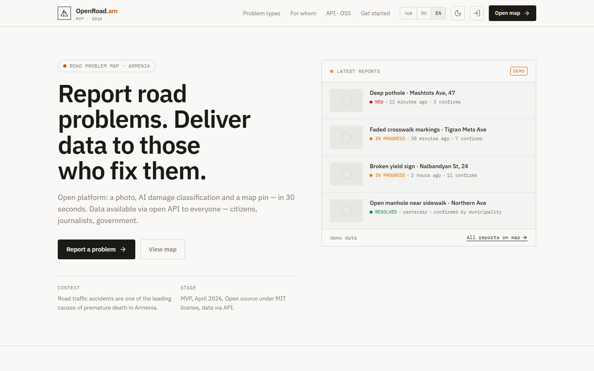
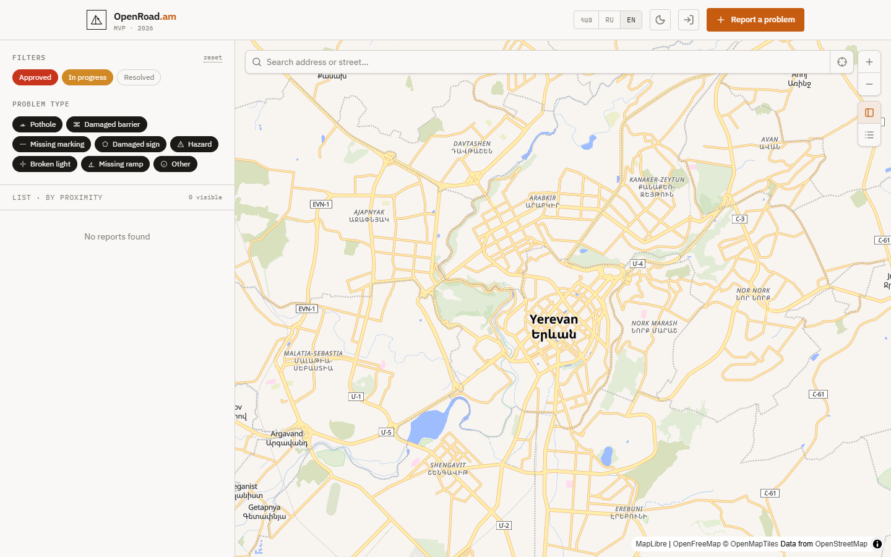
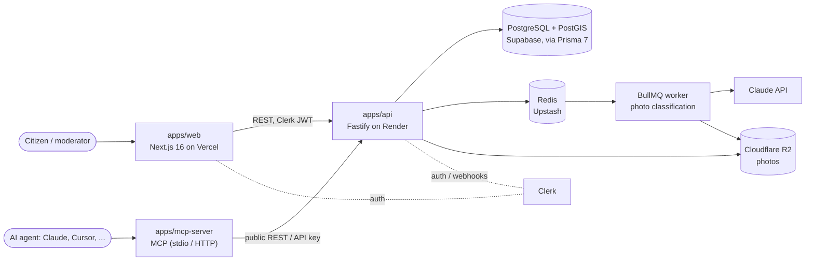

# OpenRoad.am

[](https://github.com/nightlightmare/open-roads-am/actions/workflows/ci.yml)
[](LICENSE)

**Report road problems in Armenia: a map, AI photo classification, moderation and an open API.**

Road traffic accidents are one of the leading causes of premature death in Armenia, and many of them start with
a pothole, a missing sign or a broken traffic light that nobody reported to the people who can fix it.
OpenRoad.am lets anyone with a phone take a photo, have it classified by AI, drop a pin on the map and send it
to moderation. Approved reports are public: on the map, through a read-only REST API and through an MCP server,
so citizens, journalists, municipalities and AI agents all work from the same data.

**Production:** https://open-roads-am-web.vercel.app (MVP; interface in Armenian, Russian and English)

| Landing | Map |
|---|---|
|  |  |

<!-- TODO(owner): add a screenshot or GIF of the report form (/submit). It requires a signed-in account,
     so it was not captured automatically. Save it as docs/screenshots/submit.png and add it to the table. -->

## How it works

1. A signed-in user uploads a photo. The API stores it in Cloudflare R2 and queues an AI classification job.
2. A BullMQ worker sends the photo to Claude, which suggests a problem type (pothole, damaged sign, missing
   marking, ...) with a confidence score. The user confirms or changes it, pins the location and submits.
3. Moderators review new reports; approved reports appear on the public map. Government agencies can move them
   to *in progress* and *resolved* with an API key.
4. Everyone can read approved reports through the public API or the MCP server.

## Architecture



- **Public API** (`/api/v1/public/`): read-only, no auth, rate limited by IP.
- **Internal API** (`/api/v1/`): Clerk JWT, roles `user`, `moderator`, `gov_agency`, `admin`.
- AI classification is always asynchronous, so report creation never waits for the model.
  The model is set by `CLASSIFY_MODEL` (see [Spec 03](specs/03-ai-classification.md)).

## Stack

Turborepo + pnpm · TypeScript (strict) · Next.js 16, React 19, Tailwind CSS 4, MapLibre GL, next-intl ·
Fastify 5, Zod 4, Prisma 7, PostgreSQL + PostGIS, Redis, BullMQ · Clerk · Cloudflare R2 · Claude API ·
Model Context Protocol SDK · Vitest, Playwright · oxlint.

Details and rationale: [`TECH_STACK.md`](TECH_STACK.md).

## Repository layout

```
apps/
  web/          Next.js 16 web app (map, report form, profile, moderation, admin)
  api/          Fastify API, Prisma schema + migrations, BullMQ workers
  mcp-server/   MCP server for external AI agents (talks to the API, never to the DB)
  mobile/       Planned React Native + Expo app; currently an empty stub, not built or deployed
packages/
  types/        Shared TypeScript types
  config/       Shared tsconfig and oxlint config
  ui/           Placeholder for shared UI components (empty for now)
specs/          Feature specs; every feature starts here (see CLAUDE.md)
docs/           Deployment guide, screenshots
```

## Local development

Requirements: **Node.js 22** (see `.nvmrc`), **pnpm 9** (`corepack enable`), PostgreSQL with PostGIS, Redis.

```bash
pnpm install

# Local PostGIS and Redis, if you do not use Supabase / Upstash
docker run -d --name openroad-db -e POSTGRES_PASSWORD=postgres -e POSTGRES_DB=openroad -p 5432:5432 postgis/postgis:16-3.4
docker run -d --name openroad-redis -p 6379:6379 redis:7

# Environment
cp apps/api/.env.example apps/api/.env   # every variable is validated with Zod at startup
cp apps/web/.env.example apps/web/.env   # Clerk keys, NEXT_PUBLIC_API_BASE_URL=http://localhost:3001

# Database: generate the Prisma client and apply migrations
# (migrations also enable PostGIS and seed the problem types table)
pnpm --filter @open-road/api db:generate
pnpm --filter @open-road/api db:migrate

pnpm turbo dev --filter=@open-road/web --filter=@open-road/api   # web on :3000, api on :3001
```

You need your own Clerk application, R2 bucket and Claude API key; the step-by-step setup for every external
service is in [`docs/deployment.md`](docs/deployment.md). To run the MCP server against your API:
`API_BASE_URL=http://localhost:3001 pnpm --filter @open-road/mcp-server dev`.

## Tests and checks

```bash
pnpm lint        # oxlint
pnpm typecheck   # tsc --noEmit in every package
pnpm test        # Vitest unit and integration tests (Prisma, Redis and Claude are mocked)

# End-to-end (Playwright, needs a Clerk test instance and seeded data; see specs/11-e2e-tests.md)
pnpm --filter @open-road/web test:e2e
```

Husky runs lint-staged on commit and `turbo typecheck test` for affected packages on push. GitHub Actions runs
lint, typecheck and tests on every pull request, applies all migrations to a fresh PostGIS database, and can run the
Playwright suite nightly once the E2E secrets are configured.

## Project docs

- [`specs/`](specs): one spec per feature (data model, report submission, AI classification, public API,
  moderation, auth, MCP server, ...). Implementation follows the spec.
- [`progress.md`](progress.md): what is actually implemented, updated with every change.
- [`docs/deployment.md`](docs/deployment.md): Clerk, Supabase, Upstash, R2, Render and Vercel setup.
- [`CLAUDE.md`](CLAUDE.md): development rules (branches, testing, security principles, locked product decisions).

## License

[MIT](LICENSE) © 2026 Petr Grishin
